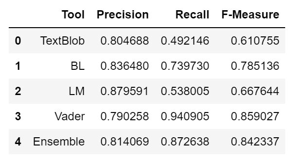
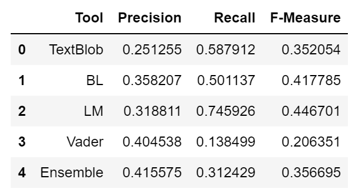

# Women's Clothing Reviews: Sentiment and Trend Analysis

An academic group project evaluating sentiment tools and exploring customer feedback about women's clothing sold online. The analysis compares sentiment across age groups and product departments to identify themes in fit, comfort, quality, and style.

[View the portfolio project](https://shetty21.github.io/#/projects/womens-clothing-review-analysis)

## Business question

How can customer reviews help an online clothing retailer understand satisfaction and identify product improvements?

## Dataset

The presentation describes a Kaggle dataset with **23,486 reviews and 10 variables**: Clothing ID, Age, Title, Review Text, Rating, Recommended IND, Positive Feedback Count, Division Name, Department Name, and Class Name.

The dataset and an exact Kaggle download URL were not supplied. The counts above describe the input dataset, not a verified count of reviews remaining after preprocessing.

## Method

1. Preprocess review text using tokenization and removal of stop words and punctuation.
2. Use part-of-speech tagging to examine descriptive nouns and adjectives.
3. Compare Bing Liu's lexicon, the LM dictionary, TextBlob, VADER (NLTK), and an ensemble approach.
4. Evaluate each approach against rating-derived reference labels: ratings **1-3 = negative**, ratings **4-5 = positive**.
5. Compare precision, recall, and F-measure separately for positive and negative reviews.
6. Explore frequent terms and word clouds by age group and product department.

The reference labels are proxies based on star ratings, not independently annotated sentiment. The submitted deck does not specify enough implementation detail to recreate its ensemble exactly.

## Reported evaluation

The following F-measures come from the original tables on slide 9. Values are rounded to three decimal places.

| Approach | Positive reviews | Negative reviews |
| --- | ---: | ---: |
| TextBlob | 0.611 | 0.352 |
| Bing Liu lexicon | 0.785 | 0.418 |
| LM dictionary | 0.668 | **0.447** |
| VADER | **0.859** | 0.206 |
| Ensemble | 0.842 | 0.357 |

VADER produced the highest positive-review F-measure, while the LM dictionary produced the highest negative-review F-measure. The ensemble did not outperform the strongest individual tool for either class. Negative sentiment was harder to identify in this evaluation.

## Review themes and business implications

The presentation reports recurring complaints about sizing, materials, and comfort. Terms such as "tight" and "small" appear in negative feedback about Bottoms and Dresses, while positive feedback discusses comfort and style.

These descriptive patterns suggest areas for retailer investigation, such as improving fit guidance and checking material quality. They do not establish the causes of dissatisfaction or prove differences between age groups. Word frequency alone does not measure issue prevalence or importance.

## Limitations

- Rating-derived labels can disagree with the sentiment expressed in review text.
- Class-specific results show that a tool effective for positive feedback can miss negative feedback.
- Age-group comparisons reflect the review sample and group definitions used in the original project, not universal generational preferences.
- The findings and metrics are documented from the submitted presentation and have not been independently reproduced here.

## Team and materials

This is an academic **Group 10** project included in Abhidith Shetty's portfolio. It is a team submission. Individual responsibilities were not supplied, so no individual contribution breakdown is asserted here.

| File | Purpose |
| --- | --- |
| [Positive-review evaluation](assets/positive-review-evaluation.png) | Original table extracted from slide 9 |
| [Negative-review evaluation](assets/negative-review-evaluation.png) | Original table extracted from slide 9 |

This repository contains a project summary and selected evaluation figures. The original PowerPoint remains private and is not distributed here. Analysis code, notebooks, and raw review data were not supplied and are not included. It is not currently a reproducible analysis package.
